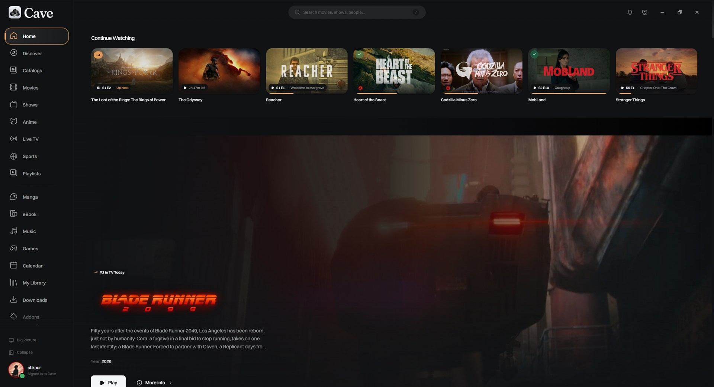

<picture>
  <source media="(prefers-color-scheme: dark)" srcset="./media/cave-wordmark-dark.svg">
  <source media="(prefers-color-scheme: light)" srcset="./media/cave-wordmark-light.svg">
  
</picture>

### Movies, shows, anime, live TV, manga and music. One app, watched together.

A desktop Stremio client with a native libmpv player, watch parties with friends, 
Discord built in, badges for everything you watch, and a theme engine that reshapes the whole app.

 

 &nbsp;
 &nbsp;
 &nbsp;

 

The Cave home screen: pick up where you left off, with today's top titles playing behind.

 

## ✨ What's inside

<table>
<tr>
<td width="33%" valign="top">

### 🎬 Watch
A native **libmpv** player with 4K, HDR and Dolby Vision, a **Rust** engine that ranks streams, **Live TV with DVR**, an anime room, and trailers everywhere.

</td>
<td width="33%" valign="top">

### 🍿 Together
**Watch parties** that stay in sync, host controls, drawing on the video, chat, and one-click **Join from Discord**.

</td>
<td width="33%" valign="top">

### 🏅 Progress
**Badges** and levels from verified watch time, synced with **Trakt**, **Simkl** and **Letterboxd**, and a public profile on cavehub.top.

</td>
</tr>
<tr>
<td width="33%" valign="top">

### 📚 Read & Listen
**Manga** with a built-in Suwayomi server and Arabic sources first, **eBooks**, and **music**.

</td>
<td width="33%" valign="top">

### 💬 Social
Friends, live status, and **Messages** with typing indicators and read receipts. A rich **Discord** status for every kind of content.

</td>
<td width="33%" valign="top">

### 🎨 Yours
A **theme engine**, 17 app icons, custom profile banners, and a 10-foot **Big Picture** mode for the TV and controller.

</td>
</tr>
</table>

## 🧱 What we build

| | | |
|---|---|---|
| **Cave Desktop** | The app |     |
| **Cave API** | Accounts, sync, profiles and app updates |   |
| **Cave Website** | Profiles, leaderboard and live watching at [cavehub.top](https://cavehub.top) |  |

## 🔑 Get Cave

Cave is **invite-only** for now. Builds and updates reach invited members with a Cave account.

> [!IMPORTANT]
> Cave is a media player and a client for the open Stremio addon protocol. It hosts, indexes, and ships no media, and it bundles no content addons. Use it with your own media and sources you are authorized to access. Cave uses Trakt but is not endorsed or certified by Trakt.

 
Made with care by the CaveHub team.

