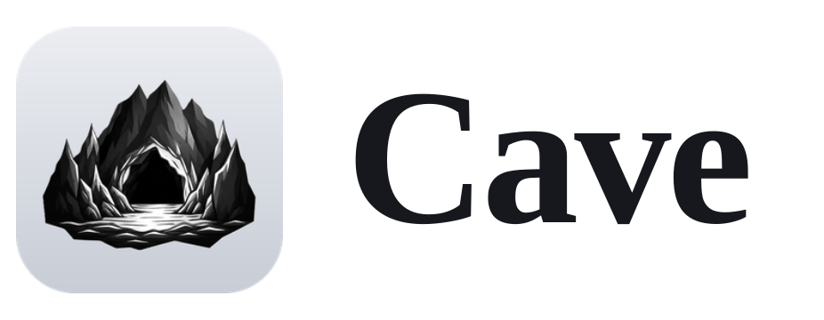

<picture>
  <source media="(prefers-color-scheme: dark)" srcset="./media/cave-wordmark-dark.svg">
  <source media="(prefers-color-scheme: light)" srcset="./media/cave-wordmark-light.svg">
  
</picture>

### A Stremio client built for adventure

A native libmpv player, a Rust stream ranking engine, watch parties, Live TV with DVR, 
an anime room, a 10-foot Big Picture mode, music, games, and a theme engine that reshapes the whole app. 
Cave uses Trakt but is not endorsed or certified by Trakt.

 

 &nbsp;
 &nbsp;
 &nbsp;
 &nbsp;

 

## What we build

| | |
|---|---|
| **Cave Desktop** | The app: Tauri 2, React, TypeScript, Rust, and libmpv, on Windows, macOS, and Linux. |
| **Cave API** | The backend behind Cave accounts, sync, and app updates. |

## Get Cave

Cave is **invite-only** for now. Builds are shared only with invited members.

> [!IMPORTANT]
> Cave is a media player and a client for the open Stremio addon protocol. It hosts, indexes, and ships no media, and it bundles no content addons. Use it with your own media and sources you are authorized to access.

Made with care by the CaveHub team.

